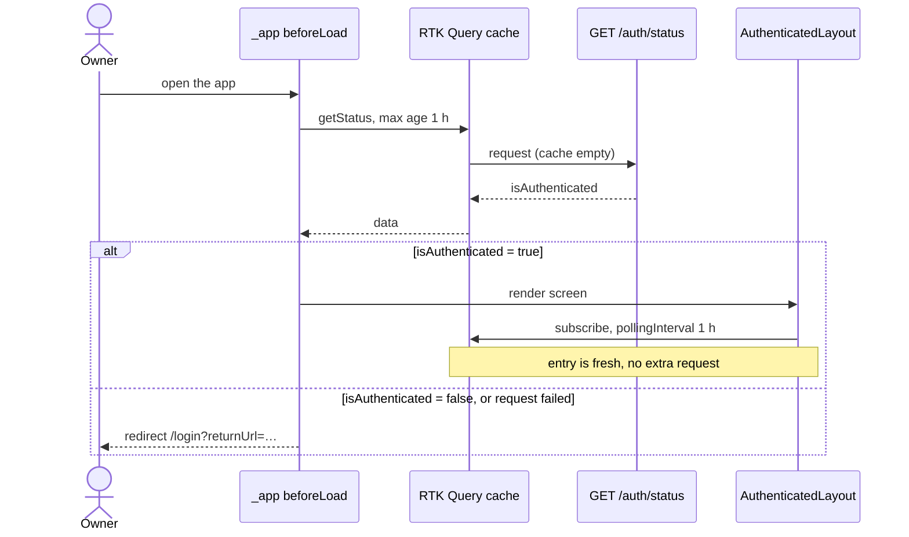
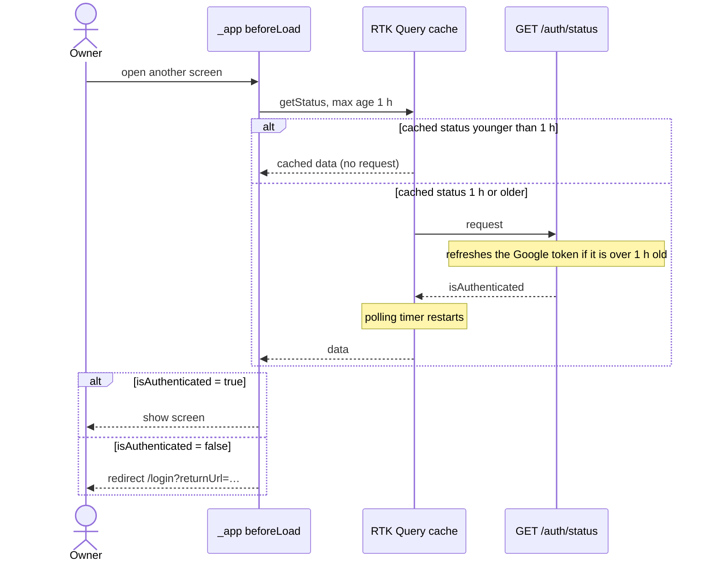
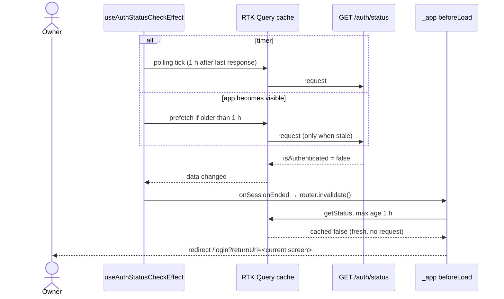
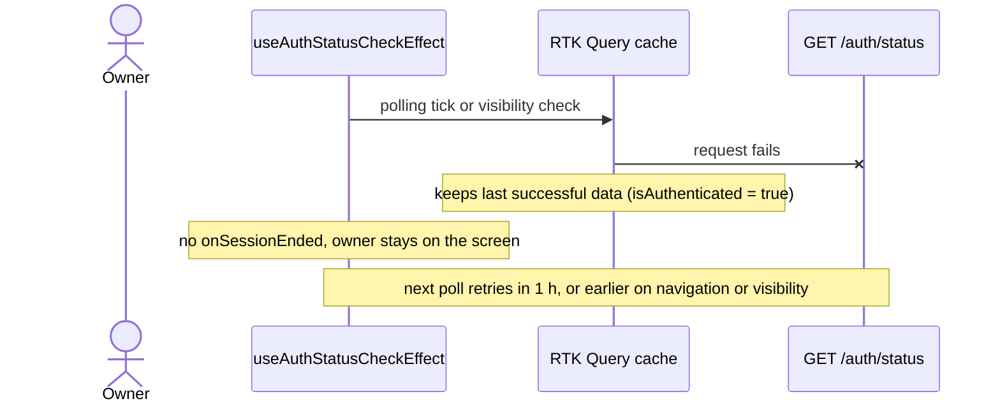

# Spec: Fewer auth status requests

Status: resolved

## Problem Statement

The authenticated layout (`src/frontend/src/app/routes/_app.tsx`) sends `GET /api/v1/auth/status` before every navigation to a new screen (`forceRefetch: !preload && !staysOnSameScreen`). Moving between sections therefore costs one auth status request per screen, which is mostly wasted:

- The backend contacts Google only when the stored Google access token is older than `AccessTokenRefreshInterval` (1 hour, `src/backend/src/FoodDiary.Constants/Constants.cs`). A status request within that hour reads the session cookie and nothing else.
- The session cookie lasts 7 days and slides on every authenticated request, so it almost never ends partway through a visit.

The auth status check still has three jobs that must keep working:

1. **Launch gate**: when the app opens, decide between the signed-in screens and the sign-in screen.
2. **Token refresh**: call the status endpoint at least once per hour while the app is in use, so that the backend refreshes the Google token and notices revoked Google access.
3. **Session end**: when the session has ended, show the sign-in screen and keep the screen the owner was on as the return address.

The current periodic check also has two defects:

- On session end it calls `signOut`, which navigates to `/api/v1/auth/logout`. That endpoint is `[Authorize]`; with no valid session its challenge redirects to the Google account picker (verified on 2026-11-16: `302 Location: https://accounts.google.com/o/oauth2/v2/auth?…prompt=select_account%20consent`). After the owner signs in, Google returns them to `logout`, which signs them out again.
- It signs the owner out when the status request fails for any reason, including being offline.

## Solution

One rule decides whether any trigger sends a request: **a cached auth status younger than `AUTH_CHECK_INTERVAL` is reused; an older one is refetched.** RTK Query provides this rule natively (`initiate(arg, { forceRefetch: <seconds> })` and `usePrefetch(endpoint, { ifOlderThan: <seconds> })`), so no hand-written freshness logic is needed.

Three triggers use that rule:

| Trigger | Where | Mechanism |
| --- | --- | --- |
| Navigation | `_app` `beforeLoad` | `initiate({}, { forceRefetch: AUTH_STATUS_MAX_AGE_SECONDS, subscribe: false })` |
| App becomes visible | `useAuthStatusCheckEffect` | `visibilitychange` listener calling `usePrefetch('getStatus', { ifOlderThan: AUTH_STATUS_MAX_AGE_SECONDS })` |
| Timer | `useAuthStatusCheckEffect` | `useGetStatusQuery({}, { pollingInterval: AUTH_CHECK_INTERVAL })` |

The polling subscription also keeps the cached status alive. Without a subscriber, RTK Query removes the entry after `keepUnusedDataFor` (60 s), and the one-hour window would never get a cache hit.

When any trigger receives `isAuthenticated: false`, the hook calls `onSessionEnded`. The layout wires it to `router.invalidate()`, which re-runs `_app` `beforeLoad`. That `beforeLoad` finds the fresh cached `false` and redirects to `/login?returnUrl=<current screen>` without another request. The hook no longer calls `signOut`.

Only an explicit `isAuthenticated: false` ends the session. A failed request leaves the last known status in the cache.

The outcome: navigating between screens sends no auth status request while the cached status is under an hour old. While the app is open, a status request goes out at least once an hour.

## User Stories

1. As the owner, I want moving between screens not to send an auth status request each time, so that the app makes fewer network requests.
2. As the owner, I want the app to open on the sign-in screen when I have no session, so that I can sign in.
3. As the owner, I want the app to keep refreshing my Google sign-in at least hourly while I use it, so that a revoked Google access ends my session within the hour.
4. As the owner, I want to see the sign-in screen when my session ends while I'm on a screen, so that I do not work in a broken app.
5. As the owner, I want to return to the screen I was on after signing in again, so that I can continue where I was.
6. As the owner, I want the app to check my session when I bring it back from the background, so that a session that ended overnight is noticed right away.
7. As the owner, I want a lost network connection not to sign me out, so that I can keep reading cached screens offline.

## Implementation Decisions

### Freshness window

- `AUTH_STATUS_MAX_AGE_SECONDS = AUTH_CHECK_INTERVAL / 1000`, defined in `features/auth`. `AUTH_CHECK_INTERVAL` (`VITE_APP_AUTH_CHECK_INTERVAL`, default 1 hour) stays the only setting.
- Windows shorter than an hour add little security, because the backend contacts Google at most once an hour per session.

### `_app` `beforeLoad`

```ts
beforeLoad: async ({ context, location }) => {
  const { data } = await context.store.dispatch(
    authApi.endpoints.getStatus.initiate(
      {},
      { forceRefetch: AUTH_STATUS_MAX_AGE_SECONDS, subscribe: false },
    ),
  );

  if (data?.isAuthenticated !== true) {
    throw redirect({ to: '/login', search: { returnUrl: location.href } });
  }
},
```

- The `staysOnSameScreen` and `preload` branches go away; the freshness rule covers them.
- `subscribe: false` replaces the `try`/`finally` with `unsubscribe()`. RTK Query starts the removal timer on `fulfilled`/`rejected` when no subscribers remain, the same as after `unsubscribe()`, and `refetch`/`prefetch` use `subscribe: false` internally.
- If a refetch fails, RTK Query keeps the last successful `data`, so offline navigation keeps the last known status (story 7). With no successful status yet (first launch offline), `data` is `undefined` and the owner lands on the sign-in screen, as today.

### `/login` `beforeLoad`

Keeps `forceRefetch: true`, so a stale "authenticated" result never bounces a signed-out owner back into the app. It switches to `subscribe: false` the same way.

### `useAuthStatusCheckEffect`

```ts
export const useAuthStatusCheckEffect = (onSessionEnded: () => void): void => {
  const { data } = authApi.useGetStatusQuery({}, { pollingInterval: AUTH_CHECK_INTERVAL });
  const prefetchStatus = authApi.usePrefetch('getStatus', {
    ifOlderThan: AUTH_STATUS_MAX_AGE_SECONDS,
  });

  useEffect(() => {
    if (data?.isAuthenticated === false) {
      onSessionEnded();
    }
  }, [data, onSessionEnded]);

  useEffect(() => {
    const handleVisibilityChange = (): void => {
      if (document.visibilityState === 'visible') {
        prefetchStatus({});
      }
    };

    document.addEventListener('visibilitychange', handleVisibilityChange);
    return () => document.removeEventListener('visibilitychange', handleVisibilityChange);
  }, [prefetchStatus]);
};
```

- The polling timer restarts after every response, so a status request sent by navigation also postpones the next poll.
- `refetchOnFocus` and `skipPollingIfUnfocused` are not used: both need `setupListeners`, and `refetchOnFocus` refetches on every focus regardless of the freshness window.
- `onSessionEnded` reacts to every `false` in the cache, whichever trigger fetched it. When navigation fetched it, `beforeLoad` and `onSessionEnded` both lead to the same `/login` redirect.

### Authenticated layout

```tsx
function AuthenticatedLayout() {
  const router = useRouter();
  const handleSessionEnded = useCallback(() => {
    void router.invalidate();
  }, [router]);

  useAuthStatusCheckEffect(handleSessionEnded);
  // ...
}
```

### Fake auth

Real sign-in and sign-out reload the page, which empties the RTK Query cache. With `VITE_APP_FAKE_AUTH_ENABLED` (used by the frontend tests and backend-less development), `signIn` and `signOut` navigate without a reload, so a fresh cached status from before would be reused for up to an hour. Example: the sign-in screen caches `false`, fake `signIn` navigates to the diary, `_app` reuses `false` and bounces back to the sign-in screen.

In their fake-auth branches, `signIn` and `signOut` write the new status into the cache (`authApi.util.upsertQueryData('getStatus', {}, { isAuthenticated })`). Their callers (`SignInForm`, `NavigationDrawerActions`) pass the store's `dispatch`, keeping `features/auth/lib` free of an `@/app/store` import.

### Frontend architecture

| Layer | Slice | Segment | Change |
| --- | --- | --- | --- |
| app | routes | `_app.tsx` | `beforeLoad` uses the freshness window and `subscribe: false`; layout passes `onSessionEnded` |
| app | routes | `login.tsx` | `subscribe: false` instead of `try`/`finally` |
| features | auth | constants | Adds `AUTH_STATUS_MAX_AGE_SECONDS` |
| features | auth | hooks | `useAuthStatusCheckEffect` polls, checks on visibility, reports `onSessionEnded` |
| features | auth | lib | `signIn`/`signOut` take `dispatch` and update the cached status in fake-auth mode |
| features | auth | ui | `SignInForm` passes `dispatch` to `signIn` |
| widgets | Navigation | ui | `NavigationDrawerActions` passes `dispatch` to `signOut` |

No new slices and no new Redux state. All triggers share the existing RTK Query cache entry `getStatus({})`.

## Sequence diagrams

### App launch



### Navigation between screens



### Session ends while a screen is open



### Request fails (offline, server down)



## Rebuilt flow: auth status check

| Behaviour today | Kept / dropped |
| --- | --- |
| App launch with no session shows the sign-in screen with `returnUrl` | Kept |
| `/login` while signed in redirects to the diary | Kept |
| Every navigation to a new screen sends a status request | Dropped: only when the cached status is 1 h or older |
| Preloads and same-screen search-param changes reuse the cached status | Kept (covered by the freshness rule) |
| Status checked every `AUTH_CHECK_INTERVAL` while signed in | Kept (RTK Query polling instead of `setInterval`) |
| Periodic check that finds no session calls `signOut` (Google account picker, then post-logout) | Dropped: redirects to `/login?returnUrl=<current screen>` |
| Periodic check signs out when the request fails | Dropped: only an explicit `isAuthenticated: false` ends the session |
| — | New: check when the app becomes visible, subject to the freshness window |
| Sign-out button calls `signOut` | Kept |

## Testing Decisions

- `tests/app.test.tsx` "an expired session shows the sign-in screen" keeps passing: advancing fake timers by `AUTH_CHECK_INTERVAL` fires the polling tick.
- `tests/app.test.tsx` "opening another section with an expired session shows the sign-in screen" no longer holds within the window. Change it to advance time past `AUTH_CHECK_INTERVAL` before navigating, and add a test that navigating within the window sends no status request.
- Flows that cross routes stay in `tests/app.test.tsx`: session end returns to the same screen after signing in again; a failed status request keeps the owner on the screen; the visibility check refetches only when stale.
- The sign-in and sign-out tests in `tests/app.test.tsx` cover the fake-auth cache update.

## Out of Scope

- Returning 401/403 instead of a Google redirect from `/api/*` endpoints, and reacting to 401 responses on the frontend.
- Changing `/api/v1/auth/logout` to tolerate a missing session.
- Backend changes of any kind.
